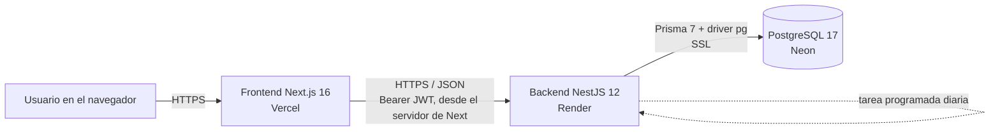

# Arquitectura

## Vista general



- El navegador solo habla con el frontend. Las páginas y las *server actions* de Next.js llaman a la API desde el servidor de Vercel (`lib/api.ts`), que es quien guarda el token en una cookie `httpOnly`. El token nunca queda expuesto al JavaScript del navegador.
- El backend valida el JWT y el rol en cada petición (guard global `JwtAuthGuard`; las rutas públicas se abren con `@Public()`).
- La base de datos vive en Neon y solo el backend tiene la cadena de conexión.

## Stack

| Capa | Tecnología | Versión |
|---|---|---|
| Frontend | Next.js (App Router) + React, Zustand (estado de sesión), Tailwind CSS, jsPDF (exportar reportes) | Next 16.4, React 19.2, Zustand 5, Tailwind 4 |
| Pruebas frontend | Vitest + Testing Library + jsdom | Vitest 4 |
| Backend | NestJS + Prisma ORM (driver adapter `@prisma/adapter-pg`), `@nestjs/jwt`, bcrypt, class-validator, `@nestjs/swagger` | NestJS 12, Prisma 7.10 |
| Pruebas backend | Vitest (unitarias y e2e) | Vitest 4 |
| Base de datos | PostgreSQL | 18 en local (Docker), 17 en Neon |
| Contenedores | Docker y docker-compose (desarrollo local) | Compose v2 |
| Lenguaje | TypeScript, ESM puro en el backend | TypeScript 5 / 6 |

## Estructura de carpetas

### Backend (`Madlions_Backend`)

```
Madlions_Backend/
├── prisma/
│   ├── schema.prisma          # modelo de datos
│   ├── migrations/            # migraciones versionadas
│   ├── seed.ts                # datos semilla (usuarios por rol, clases, máquinas)
│   └── seed-membresias.ts     # membresías de prueba (H3)
├── src/
│   ├── main.ts                # prefijo /api/v1, CORS, ValidationPipe, Swagger
│   ├── app.module.ts
│   ├── auth/  users/  health/  config/  prisma/  common/
│   ├── avisos/  estadisticas/  reportes/  ...   # un módulo Nest por dominio
│   │   ├── controllers/  services/  repositories/  dto/
│   └── generated/prisma/      # cliente generado por Prisma
├── test/                      # pruebas e2e y material de QA
├── docs/                      # esta documentación
├── docker-compose.yml  Dockerfile  .env.example
```

### Frontend (`Madlions_Frontend`)

```
Madlions_Frontend/
├── app/
│   ├── login/
│   ├── miembro/        # membresía, clases, reservas, sesiones, pagos, comprobantes, rutinas, progreso, calificar, avisos
│   ├── entrenador/     # horarios, clases, asistencia, rutinas, miembros, equipo
│   ├── recepcion/      # membresías, acceso, clases, equipo
│   ├── admin/          # planes, tipos de clase, clases, cobros, equipo, calificaciones, reportes
│   └── actions/        # server actions que llaman a la API
├── components/         # componentes reutilizables
├── lib/                # cliente HTTP (api.ts), sesión, roles y llamadas por módulo
├── stores/             # estado de sesión (Zustand)
├── proxy.ts            # protege las rutas según el token y el rol
└── tests/              # pruebas con Vitest
```

## Decisiones técnicas

| Decisión | Alternativas consideradas | Motivo |
|---|---|---|
| Dos repositorios (frontend y backend) | Monorepo | Así vienen los boilerplates de la cátedra; cada parte se despliega por separado en la plataforma que mejor le queda. |
| JWT de acceso + refresh token guardado como hash SHA-256 | Sesiones en servidor | Lo trae el Módulo 0; si se filtra la base, los refresh tokens no sirven. |
| El token vive en una cookie `httpOnly` y la API se llama desde el servidor de Next | Guardar el token en `localStorage` y llamar desde el navegador | El JavaScript del navegador no puede leer el token (menos riesgo de XSS) y no hace falta exponer la API al navegador. |
| Zustand para el estado de sesión en el cliente | Redux, Context | Mínimo código para lo que se necesita (usuario y rol). |
| Cuatro roles: MIEMBRO, ENTRENADOR, RECEPCION, ADMINISTRADOR | Recepción y administrador como un solo rol | Las historias les dan permisos distintos; con un solo rol, recepción podría cambiar precios o ver ingresos. |
| Fechas en UTC en la base, mostradas en hora de El Salvador (UTC-6) | Guardar hora local | Evita errores de zona horaria entre servidores (supuesto S16). |
| Restricciones de negocio como `CHECK` e índices únicos parciales en las migraciones | Validar solo en el servicio | La base garantiza la regla aunque haya peticiones concurrentes (p. ej., una sola reserva activa por miembro y clase). |
| Frontend en Vercel, backend en Render, base en Neon | Todo en un solo proveedor | Planes gratuitos con HTTPS; Vercel es la plataforma nativa de Next.js y Neon da PostgreSQL administrado. |
