# Modelo de datos

El esquema vive en `prisma/schema.prisma` y se crea con las migraciones de `prisma/migrations`. Las reglas que Prisma no puede expresar (rangos, formatos, coherencia entre columnas, índices únicos parciales) están como `CHECK` e índices en las migraciones. Todas las fechas se guardan en UTC.

## Diagrama entidad-relación

```mermaid
erDiagram
    USUARIO ||--o| MIEMBRO : "tiene ficha"
    USUARIO ||--o{ REFRESH_TOKENS : tiene
    USUARIO ||--o{ BLOQUE_DISPONIBILIDAD : "define (entrenador)"
    USUARIO ||--o{ CLASE : "imparte (entrenador)"
    USUARIO ||--o{ RUTINA : "crea (entrenador)"
    USUARIO ||--o{ MEMBRESIA : "registra (recepción)"
    USUARIO ||--o{ REGISTRO_ACCESO : "registra (recepción)"
    USUARIO ||--o{ HISTORIAL_MAQUINA : "cambia estado"

    TIPO_CLASE ||--o{ CLASE : clasifica
    TIPO_CLASE ||--o{ PLAN_TIPO_CLASE : "aparece en"
    PLAN ||--o{ PLAN_TIPO_CLASE : incluye
    PLAN ||--o{ MEMBRESIA : "se vende como"
    MEMBRESIA ||--o{ MEMBRESIA_TIPO_CLASE : incluye
    TIPO_CLASE ||--o{ MEMBRESIA_TIPO_CLASE : "aparece en"
    MEMBRESIA |o--o{ MEMBRESIA : renueva

    MIEMBRO ||--o{ MEMBRESIA : compra
    MIEMBRO ||--o{ RESERVA : hace
    CLASE ||--o{ RESERVA : recibe
    MEMBRESIA ||--o{ RESERVA : "se usa en"

    BLOQUE_DISPONIBILIDAD ||--o| SESION_PERSONAL : "se agenda en"
    MIEMBRO ||--o{ SESION_PERSONAL : agenda

    MIEMBRO ||--o{ COBRO : debe
    COBRO ||--o{ INTENTO_PAGO : "se intenta pagar"
    COBRO ||--o| COMPROBANTE : genera
    INTENTO_PAGO ||--o| COMPROBANTE : respalda
    COBRO |o--o| SESION_PERSONAL : cobra

    MIEMBRO ||--o{ REGISTRO_ACCESO : ingresa
    MIEMBRO ||--o{ RUTINA : recibe
    RUTINA ||--o{ RUTINA_DIA : tiene
    RUTINA_DIA ||--o{ RUTINA_EJERCICIO : tiene
    MIEMBRO ||--o{ REGISTRO_PROGRESO : registra

    MAQUINA ||--o{ HISTORIAL_MAQUINA : tiene

    MIEMBRO ||--o{ RESENA : escribe
    RESERVA |o--o| RESENA : "se califica"
    SESION_PERSONAL |o--o| RESENA : "se califica"
    USUARIO ||--o{ RESENA : "recibe (entrenador)"

    MIEMBRO ||--o{ AVISO : recibe

    USUARIO {
        uuid id PK
        string email UK
        string password_hash
        string nombre
        string apellido
        char telefono
        enum rol
        bool activo
    }
    MIEMBRO {
        uuid id PK
        uuid usuario_id FK
        char documento UK
        char codigo_miembro UK
    }
    PLAN {
        uuid id PK
        string nombre UK
        enum tipo
        decimal precio
        int cantidad_clases
        int duracion_dias
        bool activo
    }
    MEMBRESIA {
        uuid id PK
        uuid miembro_id FK
        uuid plan_id FK
        uuid membresia_anterior_id FK
        enum tipo_operacion
        enum estado
        date fecha_inicio
        date fecha_vencimiento
        uuid registrada_por FK
    }
    TIPO_CLASE {
        uuid id PK
        string nombre UK
        bool activo
    }
    CLASE {
        uuid id PK
        uuid tipo_clase_id FK
        uuid entrenador_id FK
        datetime inicio
        datetime fin
        int cupo_maximo
        enum estado
    }
    RESERVA {
        uuid id PK
        uuid clase_id FK
        uuid miembro_id FK
        uuid membresia_id FK
        enum estado
        enum asistencia
    }
    BLOQUE_DISPONIBILIDAD {
        uuid id PK
        uuid entrenador_id FK
        datetime inicio
        datetime fin
        enum estado
    }
    SESION_PERSONAL {
        uuid id PK
        uuid bloque_id FK
        uuid miembro_id FK
        uuid entrenador_id FK
        uuid cobro_id FK
        decimal precio
        enum asistencia
    }
    COBRO {
        uuid id PK
        uuid miembro_id FK
        enum concepto
        decimal monto
        enum referencia_tipo
        uuid referencia_id
        enum estado
    }
    INTENTO_PAGO {
        uuid id PK
        uuid cobro_id FK
        enum resultado
        char ultimos4
        string referencia UK
    }
    COMPROBANTE {
        uuid id PK
        string numero UK
        uuid cobro_id FK
        uuid intento_id FK
        decimal subtotal
        decimal iva
        decimal total
    }
    REGISTRO_ACCESO {
        uuid id PK
        uuid miembro_id FK
        datetime ingreso_en
        datetime salida_en
        enum estado
        string motivo_excepcion
    }
    RUTINA {
        uuid id PK
        uuid miembro_id FK
        uuid entrenador_id FK
        string nombre
        date fecha_inicio
    }
    REGISTRO_PROGRESO {
        uuid id PK
        uuid miembro_id FK
        date fecha
        enum tipo
        decimal valor
    }
    MAQUINA {
        uuid id PK
        string codigo UK
        string nombre
        enum tipo
        enum zona
        enum estado
    }
    HISTORIAL_MAQUINA {
        uuid id PK
        uuid maquina_id FK
        enum estado_anterior
        enum estado_nuevo
        string motivo
        uuid cambiado_por FK
    }
    RESENA {
        uuid id PK
        uuid miembro_id FK
        uuid reserva_id FK
        uuid sesion_id FK
        uuid entrenador_id FK
        smallint cal_actividad
        smallint cal_entrenador
        smallint cal_instalaciones
    }
    AVISO {
        uuid id PK
        uuid miembro_id FK
        string titulo
        enum modulo_origen
        string referencia
        enum estado
    }
```

Para que el diagrama se lea, no se muestran `rutina_dia`, `rutina_ejercicio`, `refresh_tokens`, `configuracion` ni las tablas puente como entidades con atributos; están descritas abajo.

## Tablas

| Tabla | Descripción | Campos importantes |
|---|---|---|
| `usuario` | Cuenta de acceso de cualquier persona. Cada usuario tiene exactamente un rol. | `email` (único), `password_hash` (bcrypt), `rol` (MIEMBRO, ENTRENADOR, RECEPCION, ADMINISTRADOR), `activo` |
| `refresh_tokens` | Refresh tokens emitidos. Se guarda el SHA-256, nunca el token en claro. | `token_hash`, `user_id`, `expires_at`, `revoked_at` |
| `miembro` | Ficha del miembro del gimnasio, ligada a un usuario. | `usuario_id` (único), `documento` (DUI), `codigo_miembro` (MBR-000001, de la secuencia `miembro_codigo_seq`) |
| `plan` | Planes que vende el gimnasio (H1). | `tipo` (DAYPASS, MENSUAL, SET_CLASES), `precio`, `cantidad_clases`, `duracion_dias`, `activo` |
| `plan_tipo_clase` | Tipos de clase que incluye cada plan. | `plan_id`, `tipo_clase_id` |
| `configuracion` | Parámetros generales clave-valor. | `clave` (p. ej. `precio_clase_puntual`), `valor` |
| `membresia` | Compra o renovación de un plan por un miembro (H2). Copia las condiciones del plan al momento de la compra. | `miembro_id`, `plan_id`, `tipo_operacion` (COMPRA, RENOVACION), `estado` (PENDIENTE_PAGO, PAGADA), `fecha_inicio`, `fecha_vencimiento`, `membresia_anterior_id` |
| `membresia_tipo_clase` | Tipos de clase copiados del plan a la membresía. | `membresia_id`, `tipo_clase_id` |
| `tipo_clase` | Catálogo de clases grupales (Spinning, Yoga, Crossfit...). | `nombre` (único), `activo` |
| `clase` | Clase grupal programada (H4, H8). | `tipo_clase_id`, `entrenador_id`, `inicio`, `fin`, `cupo_maximo` (1 a 50), `estado` (PROGRAMADA, CANCELADA_GIMNASIO) |
| `reserva` | Cupo reservado por un miembro en una clase (H5, H6, H7, H19). Una sola reserva confirmada por miembro y clase. | `clase_id`, `miembro_id`, `membresia_id`, `estado` (CONFIRMADA, CANCELADA_MIEMBRO, CANCELADA_GIMNASIO), `asistencia` |
| `bloque_disponibilidad` | Horario disponible de un entrenador para sesiones personales (H8). | `entrenador_id`, `inicio`, `fin`, `duracion_min`, `estado` (DISPONIBLE, OCUPADO) |
| `sesion_personal` | Sesión uno a uno agendada en un bloque (H9, H19). | `bloque_id` (único), `miembro_id`, `entrenador_id`, `precio`, `cobro_id`, `asistencia` |
| `cobro` | Lo que el miembro debe pagar: membresía, renovación o sesión adicional (H12, H13). | `concepto`, `monto`, `referencia_tipo` + `referencia_id` (únicos juntos), `habilitado_desde`, `estado` (PENDIENTE, PAGADO) |
| `intento_pago` | Intento de pago en la pasarela simulada (H12). Solo guarda los últimos 4 dígitos de la tarjeta. | `cobro_id`, `resultado` (APROBADO, RECHAZADO, ERROR), `ultimos4`, `referencia` (PAY-AAAAMMDD-XXXXXX) |
| `comprobante` | Comprobante de un cobro pagado (H12). | `numero` (CMP-000001), `cobro_id`, `intento_id`, `subtotal`, `iva` (13 %), `total` |
| `registro_acceso` | Ingreso y salida de un miembro (H10, H11). Un solo registro DENTRO por miembro. | `miembro_id`, `ingreso_en`, `salida_en`, `estado` (DENTRO, SALIO, CERRADO_AUTO), `estado_membresia`, `motivo_excepcion` |
| `rutina` | Rutina asignada por un entrenador a un miembro (H14, H15). | `miembro_id`, `entrenador_id`, `nombre`, `objetivo`, `fecha_inicio` |
| `rutina_dia` | Días de una rutina (máximo 7). | `rutina_id`, `orden`, `nombre` |
| `rutina_ejercicio` | Ejercicios de cada día (máximo 15). | `dia_id`, `orden`, `series`, `repeticiones`, `descanso_seg` |
| `registro_progreso` | Medidas y marcas que registra el miembro (H16). | `miembro_id`, `fecha`, `tipo` (PESO, CINTURA, ..., MARCA), `valor`, `ejercicio` |
| `maquina` | Inventario de máquinas (H17). Guarda en caché el último cambio de estado. | `codigo` (MAQ-000), `tipo`, `zona`, `estado` (OPERATIVA, EN_MANTENIMIENTO, FUERA_DE_SERVICIO), `fecha_estimada_retorno` |
| `historial_maquina` | Historia completa de cambios de estado de una máquina (H18). | `maquina_id`, `estado_anterior`, `estado_nuevo`, `motivo`, `cambiado_por` |
| `resena` | Calificación de una clase o una sesión tomada (H20, H21). Apunta a la reserva o a la sesión, nunca a las dos. | `reserva_id` o `sesion_id`, `entrenador_id`, `tipo_clase_id`, `cal_actividad`, `cal_entrenador`, `cal_instalaciones` (1 a 5) |
| `aviso` | Aviso para un miembro (Módulo 9: H22 a H25). Solo lo crea el servicio de avisos. | `miembro_id`, `titulo`, `mensaje`, `modulo_origen`, `referencia` (única por miembro, evita duplicados), `estado` (NO_LEIDO, LEIDO) |
