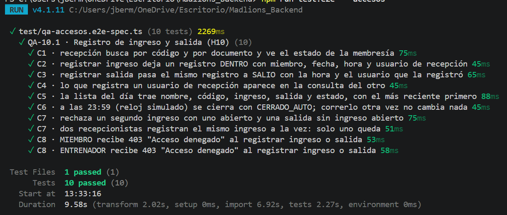

# QA-10.1. Pruebas del control de ingresos y salidas

**Historia:** H10. Registro de ingreso y salida de un miembro
**Responsable:** <tu nombre completo>
**Fecha de ejecución:** <fecha>
**Entorno:** API local (puerto 8000), frontend local (puerto 3000), PostgreSQL 18 del docker-compose, datos de `npm run db:seed`.

## Pruebas automáticas

`npm run test:e2e -- accesos` ejecuta `test/qa-accesos.e2e-spec.ts` contra la base real. Crea sus propios miembros y un segundo usuario de recepción, y los borra al terminar.

| ID | Criterio | Caso | Esperado | Resultado |
|---|---|---|---|---|
| QA-01 | C1 | Búsqueda por código y por documento | El miembro aparece con su estado de membresía | |
| QA-02 | C2 | Ingreso normal | 201; registro DENTRO con miembro, fecha, hora y usuario de recepción | |
| QA-03 | C3 | Salida normal registrada por otro usuario de recepción | 200; el mismo registro pasa a SALIO con hora y usuario de la salida | |
| QA-04 | C4 | Ingreso hecho por un usuario de recepción | Aparece en la consulta del día del otro usuario | |
| QA-05 | C5 | Lista del día | Nombre, código, ingreso, salida y estado; el más reciente primero | |
| QA-06 | C6 | Cierre automático con reloj simulado a las 23:59 | CERRADO_AUTO con salida 23:59 y sin usuario; la segunda corrida cierra 0 | |
| QA-07 | C7 | Segundo ingreso con uno abierto | 409 "El miembro ya está dentro del gimnasio" | |
| QA-08 | C7 | Salida sin ingreso abierto | 409 "El miembro no tiene un ingreso abierto" | |
| QA-09 | C7 | Dos recepcionistas registran el mismo ingreso a la vez | Una respuesta 201 y una 409; un solo registro DENTRO | |
| QA-10 | C8 | MIEMBRO registra ingreso, salida y consulta el día | 403 "Acceso denegado" | |
| QA-11 | C8 | ENTRENADOR registra ingreso, salida y consulta el día | 403 "Acceso denegado" | |

## Pruebas manuales del frontend

| ID | Criterio | Pasos | Esperado | Resultado |
|---|---|---|---|---|
| QA-12 | C1 | Recepción busca por nombre, documento y código | Coincidencias con su estado de membresía y "Registrar ingreso" | |
| QA-13 | C2, C4 | Registrar ingreso | Botón desactivado mientras se envía; "Ingreso registrado"; aparece en la lista sin recargar | |
| QA-14 | C3, C4 | Registrar salida | "Salida registrada"; en la lista queda "Salió" con la hora | |
| QA-15 | C4 | Dos ventanas con recepción: registrar en una | Aparece en la otra en 30 segundos o con "Actualizar" | |
| QA-16 | C5 | Revisar la lista del día | Columnas Nombre, Código, Ingreso, Salida y Estado; el más reciente arriba | |
| QA-17 | C7 | Registrar ingreso en una ventana y repetirlo en la otra sin actualizar | "El miembro ya está dentro del gimnasio" | |
| QA-18 | — | Día sin ingresos | "Aún no hay ingresos hoy" | |
| QA-19 | — | Pantalla a 375 px | El buscador se apila y la lista se muestra como tarjetas | |

## Resultado general

<Ej.: 19 de 19 casos pasan. Sin defectos encontrados.>

## Evidencia

Pruebas automáticas (`npm run test:e2e -- accesos`) y unitarias (`npx vitest run src/accesos`):

![Resultado de las pruebas de H10]