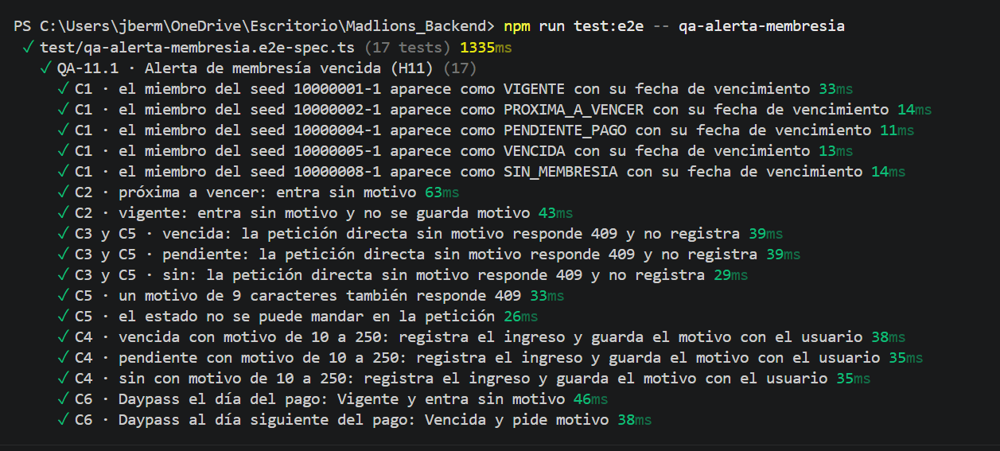

# QA-11.1. Pruebas de la alerta de membresía

**Historia:** H11. Alerta de membresía vencida
**Responsable:** Juan Francisco Bermudez Padilla
**Fecha de ejecución:** 17/11/2026
**Entorno:** API local (puerto 8000), frontend local (puerto 3000), PostgreSQL 18 del docker-compose, datos de `npm run db:seed`.

## Pruebas automáticas

`npm run test:e2e -- qa-alerta-membresia` ejecuta `test/qa-alerta-membresia.e2e-spec.ts` contra la base real. El criterio 1 usa los miembros del seed de H3; los ingresos usan miembros propios que se borran al terminar.

| ID | Criterio | Caso | Esperado | Resultado |
|---|---|---|---|---|
| QA-01 | C1 | Búsqueda de los miembros del seed: Vigente, Próxima a vencer, Pendiente de pago, Vencida y Sin membresía | Cada uno con su estado y su fecha de vencimiento (nula si no aplica) |✓ |
| QA-02 | C2 | Próxima a vencer sin motivo | 201 |✓ |
| QA-03 | C2 | Vigente con motivo | 201 y el motivo no se guarda | ✓|
| QA-04 | C3, C5 | Vencida sin motivo (petición directa a la API) | 409 "Se requiere un motivo de excepción"; no registra | ✓|
| QA-05 | C3, C5 | Pendiente de pago sin motivo (petición directa a la API) | 409; no registra | ✓|
| QA-06 | C3, C5 | Sin membresía sin motivo (petición directa a la API) | 409; no registra |✓ |
| QA-07 | C5 | Motivo de 9 caracteres | 409 | ✓|
| QA-08 | C5 | Enviar `estadoMembresia` en el cuerpo | 400; el estado no se acepta del cliente |✓ |
| QA-09 | C4 | Vencida, Pendiente de pago y Sin membresía con motivo válido | 201; motivo guardado con el estado y el usuario de recepción |✓ |
| QA-10 | C6 | Daypass el día del pago | Vigente y entra sin motivo |✓ |
| QA-11 | C6 | Daypass al día siguiente | Vencida y pide motivo |✓ |

> QA-10: el servicio del Módulo 1 (BE-2.4) devuelve "Próxima a vencer" para un Daypass el día del pago (0 días restantes). El ingreso funciona igual (entra sin motivo), pero la etiqueta no coincide con el criterio. Pendiente de definir con el equipo de H3.

## Pruebas manuales del frontend

| ID | Criterio | Pasos | Esperado | Resultado |
|---|---|---|---|---|
| QA-12 | C1 | Recepción busca `estado` | Cada miembro con su etiqueta de color y "Vence el …" | ✓|
| QA-13 | C2 | Miembro próximo a vencer | Etiqueta amarilla, aviso "Vence en n días (fecha)" y "Registrar ingreso" normal | ✓|
| QA-14 | C3 | Miembro vencido, pendiente de pago y sin membresía | Etiqueta y alerta rojas; el botón cambia a "Registrar ingreso con excepción" |✓ |
| QA-15 | C4 | Escribir un motivo de menos de 10 caracteres | El contador lo marca y "Confirmar ingreso con excepción" queda desactivado |✓ |
| QA-16 | C4 | Escribir un motivo válido y confirmar | "Ingreso registrado con excepción"; aparece en la lista como Dentro |✓ |
| QA-17 | — | Pantalla a 375 px | Alerta, botón y campo de motivo se ven completos |✓ |

## Resultado general

<Ej.: 16 de 17 casos pasan. QA-10 falla por la regla del Daypass del Módulo 1, reportada al equipo.>

## Evidencia

Pruebas automáticas (`npm run test:e2e -- qa-alerta-membresia`) y unitarias (`npx vitest run src/accesos`):

![Resultado de las pruebas de H11]