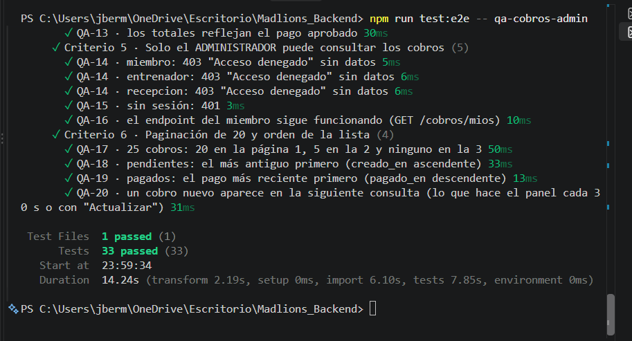

# QA-13.1. Pruebas de la consulta de cobros pendientes

**Historia:** H13. Consulta de cobros pendientes
**Responsable:** Juan Francisco Bermudez Padilla
**Fecha de ejecución:** 19/11/2026
**Entorno:** API local (puerto 8000), frontend local (puerto 3000), PostgreSQL 18 del docker-compose, datos de `npm run db:seed`.

## Pruebas automáticas

`npm run test:e2e -- qa-cobros-admin` ejecuta `test/qa-cobros-admin.e2e-spec.ts` contra la base real. Crea seis miembros propios (apellido "QA13 …") con sus cobros y los borra al terminar. Los pagos aprobado y rechazado pasan por la pasarela simulada de H12.

| ID | Criterio | Caso | Esperado | Resultado |
|---|---|---|---|---|
| QA-01 | C1 | Consulta sin estado y con `estado=PAGADO` | Sin estado solo pendientes; con PAGADO solo pagados | ✓ |
| QA-02 | C1 | Filtro por concepto MEMBRESIA, RENOVACION y SESION_ADICIONAL | Solo cobros del concepto elegido | ✓ |
| QA-03 | C1 | Búsqueda por código completo, en minúsculas y parcial | Solo los cobros de ese miembro | ✓ |
| QA-04 | C1 | Búsqueda "nunez" para el apellido "Núñez" | Encuentra al miembro sin tildes ni mayúsculas | ✓ |
| QA-05 | C1 | Búsqueda sin coincidencias | 200 con lista vacía, total 0 y suma 0 | ✓ |
| QA-06 | C1 | Estado, concepto, página o búsqueda incorrectos, o un parámetro que no existe | 400 con el mensaje del filtro | ✓ |
| QA-07 | C2 | Cantidad y suma con cada filtro (todos, por concepto y pagados) | Coinciden con el conjunto filtrado | ✓ |
| QA-08 | C2 | Página 2 de 25 cobros | 5 cobros en la página, pero total 25 y suma 250.00 | ✓ |
| QA-09 | C3 | Renovación que se habilita en 10 días | Pendiente con `habilitado: false` y su fecha de habilitación | ✓ |
| QA-10 | C3 | Membresía y sesión adicional pendientes | Habilitadas desde que se generan | ✓ |
| QA-11 | C4 | Pago aprobado (tarjeta 4242) | Sale de Pendientes y aparece en Pagados con fecha y referencia | ✓ |
| QA-12 | C4 | Pago rechazado (tarjeta 0002) | Sigue en Pendientes y no aparece en Pagados | ✓ |
| QA-13 | C4 | Totales después del pago aprobado | Pendientes bajan y Pagados suben en el monto pagado | ✓ |
| QA-14 | C5 | Consulta con MIEMBRO, ENTRENADOR y RECEPCION | 403 "Acceso denegado", sin datos | ✓ |
| QA-15 | C5 | Consulta sin sesión | 401 | ✓ |
| QA-16 | C5 | `GET /cobros/mios` del miembro (H12) | Sigue funcionando | ✓ |
| QA-17 | C6 | 25 cobros de un miembro | Página 1: 20, página 2: 5, página 3: vacía, sin repetidos | ✓ |
| QA-18 | C6 | Orden de los pendientes | Por fecha de creación, el más antiguo primero | ✓ |
| QA-19 | C6 | Orden de los pagados | Por fecha de pago, el más reciente primero | ✓ |
| QA-20 | C6 | Se crea un cobro y se vuelve a consultar | Aparece en la siguiente consulta (la que hace el panel) | ✓ |

## Pruebas manuales del frontend

Iniciar sesión con `admin@madlions.com` / `Demo1234!` y entrar a **Cobros pendientes** (`/admin/cobros`).

| ID | Criterio | Pasos | Esperado | Resultado |
|---|---|---|---|---|
| QA-21 | C1 | Cambiar entre las pestañas Pendientes y Pagados y filtrar por concepto | La tabla y las tarjetas cambian con cada filtro | ✓ |
| QA-22 | C1 | Buscar un miembro por nombre y luego por código | Solo aparecen sus cobros; "Limpiar" quita la búsqueda | ✓ |
| QA-23 | C2 | Comparar las tarjetas con la tabla | La cantidad y la suma corresponden a los filtros aplicados | ✓ |
| QA-24 | C3 | Registrar en recepción una renovación a un miembro con membresía vigente | En Pendientes aparece la etiqueta gris "Pendiente, aún no habilitado" con "Desde el …" | ✓ |
| QA-25 | C4 | El miembro paga un cobro con 4242 y luego otro con 0002 | El aprobado pasa a Pagados; el rechazado sigue en Pendientes | ✓ |
| QA-26 | C5 | Entrar a `/admin/cobros` como miembro, entrenador y recepción | "Acceso denegado", sin ningún dato de cobros | ✓ |
| QA-27 | C6 | Con más de 20 cobros, usar "Siguiente" y "Anterior" | 20 por página, "Mostrando 1–20 de N" y "Página X de Y" | ✓ |
| QA-28 | C6 | Dejar el panel abierto mientras un miembro paga | Se actualiza solo en 30 s como máximo; "Actualizar" lo hace al momento | ✓ |
| QA-29 | — | Filtrar sin resultados en Pendientes | "No hay cobros pendientes" | ✓ |
| QA-30 | — | Pantalla a 375 px | Pestañas, filtros, tarjetas y tabla (con desplazamiento horizontal) se ven completos | ✓ |

## Resultado general

<Ej.: 30 de 30 casos pasan.>

## Evidencia

Pruebas automáticas (`npm run test:e2e -- qa-cobros-admin`) y unitarias (`npx vitest run src/cobros`):

![Resultado de las pruebas de H13]